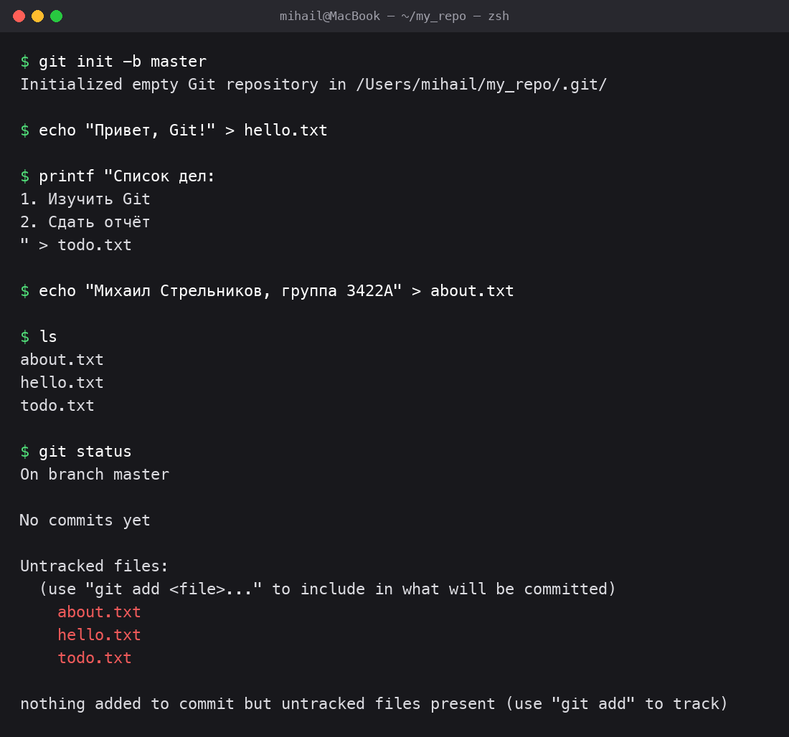
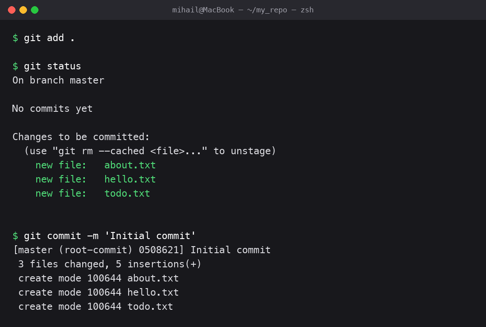
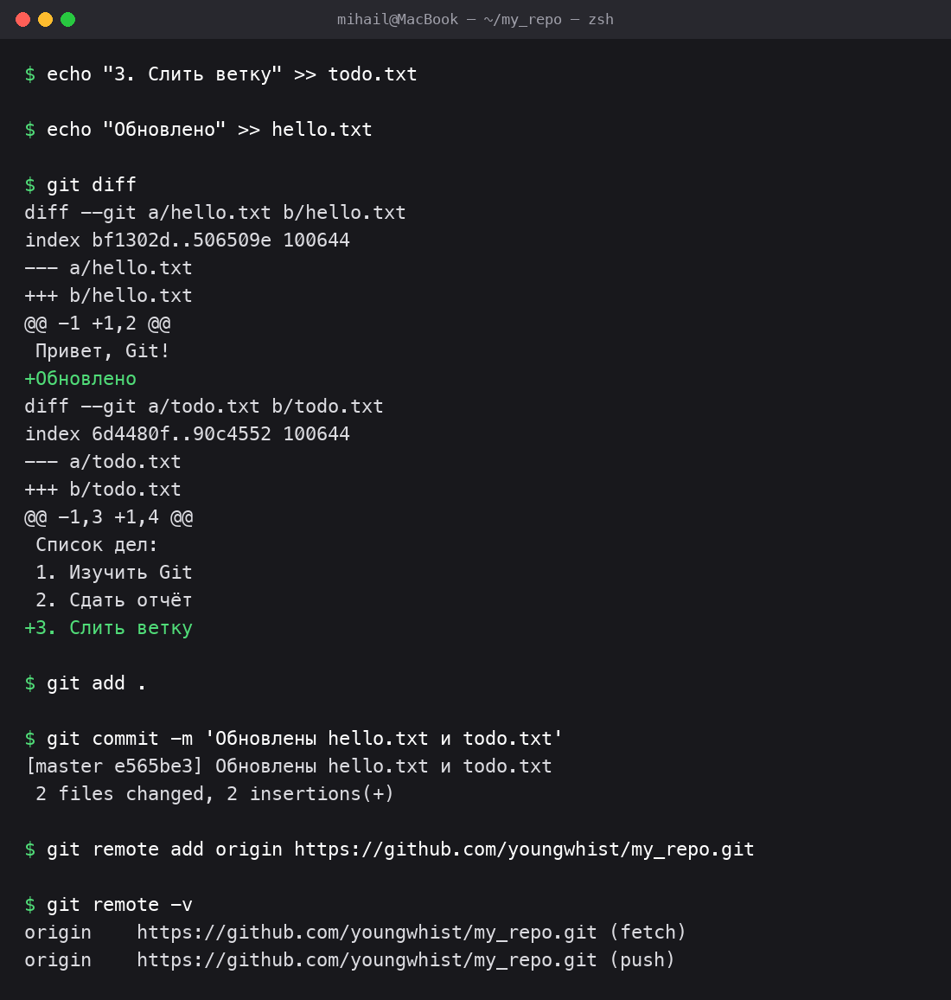
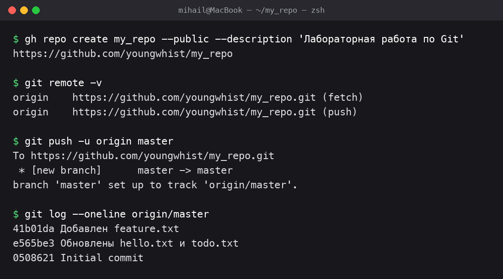
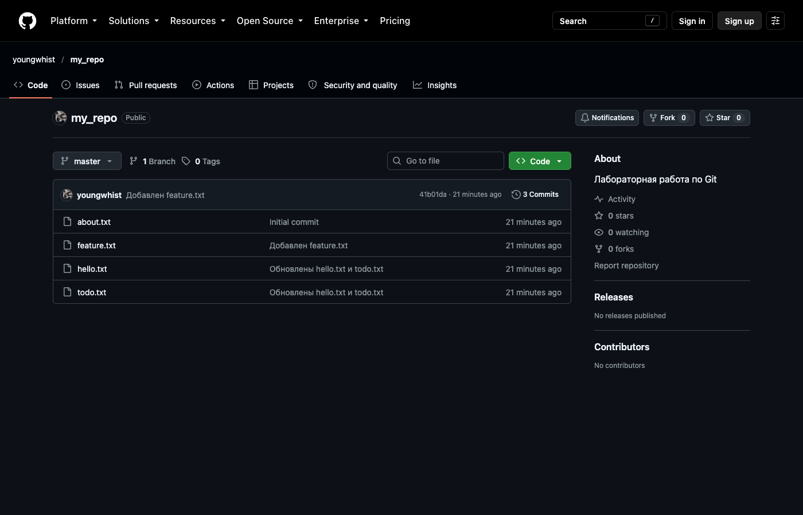
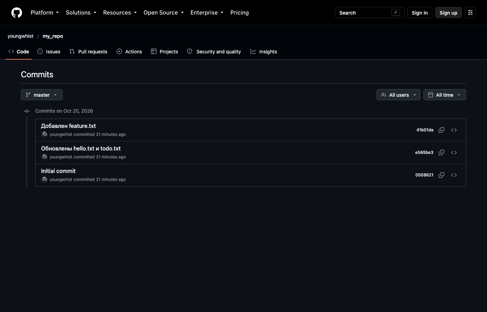
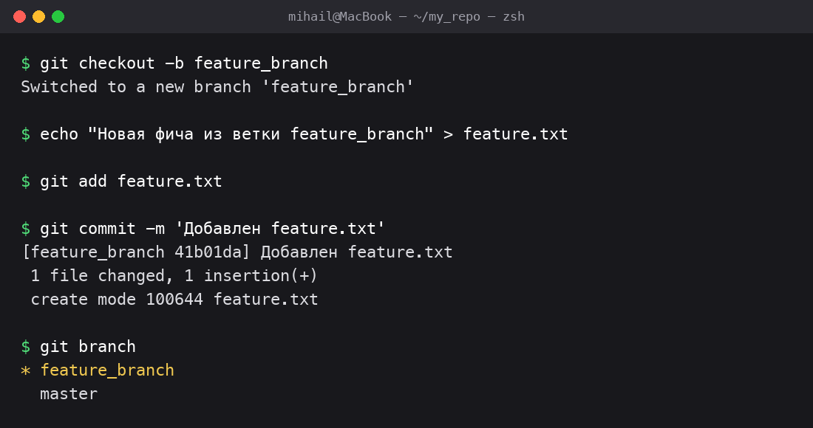
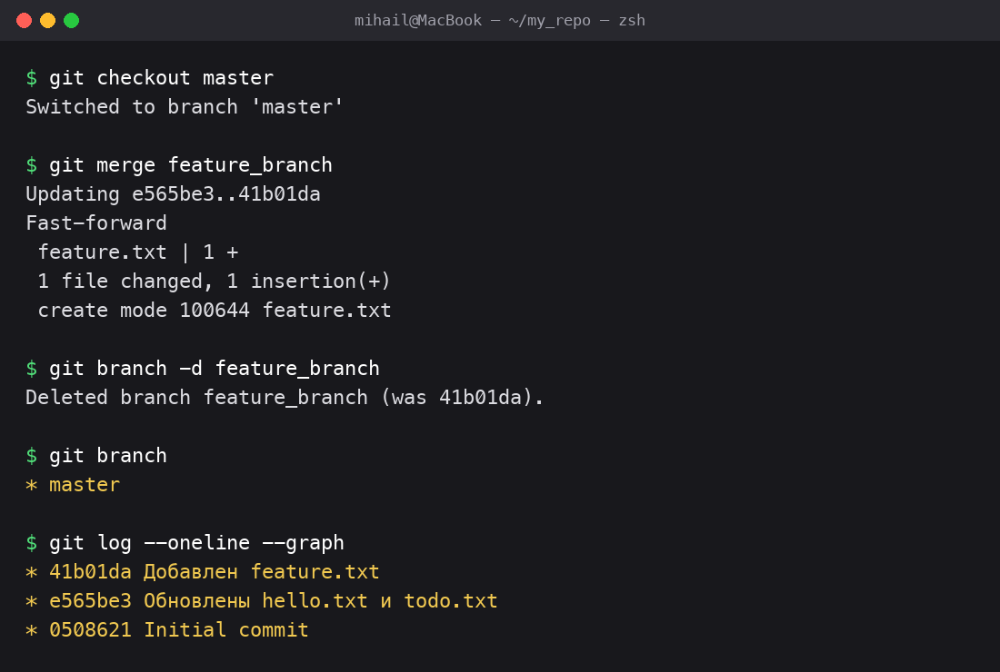
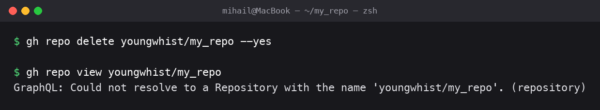
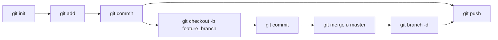

# Отчёт: работа в системе контроля версий Git

**Студент:** Стрельников Михаил Иванович
**Группа:** 3422А

## Цель

Освоить основные команды Git для работы с репозиториями и научиться применять их на практике: создание репозитория, добавление файлов, коммит, пуш, работа с ветками и слияние.

## Используемые инструменты

- Git (командная строка, терминал macOS)
- GitHub — удалённый сервер для хранения репозитория
- GitHub CLI (`gh`) — работа с GitHub из терминала

## Ход работы

### Шаг 1. Регистрация на GitHub и авторизация

1. Вошёл в свой аккаунт GitHub `youngwhist`.
2. Установил официальную утилиту GitHub CLI (`gh`) и авторизовался через браузер, чтобы работать с GitHub из терминала:

```bash
brew install gh
gh auth login -s delete_repo
gh auth status
```

Параметр `-s delete_repo` даёт право удалять репозитории — оно понадобится в последнем шаге.

### Шаг 2. Инициализация локального репозитория и создание файлов

1. Создал папку `my_repo` и выполнил `git init -b master` — Git создал скрытую папку `.git` и основную ветку `master`.
2. Создал три текстовых файла с разными данными:
   - `hello.txt` — приветствие;
   - `todo.txt` — список дел;
   - `about.txt` — информация об авторе.
3. Командой `git status` проверил состояние: все три файла отображаются как **неотслеживаемые** (Untracked files).

```bash
git init -b master
echo "Привет, Git!" > hello.txt
printf "Список дел:\n1. Изучить Git\n2. Сдать отчёт\n" > todo.txt
echo "Михаил Стрельников, группа 3422А" > about.txt
git status
```



### Шаг 3. Добавление файлов в индекс и первый коммит

1. Командой `git add .` добавил все файлы в индекс (staging area).
2. `git status` показывает, что файлы готовы к коммиту (Changes to be committed).
3. Выполнил первый коммит `git commit -m 'Initial commit'` — в истории появилась первая версия проекта (3 файла).

```bash
git add .
git status
git commit -m 'Initial commit'
```



### Шаг 4. Внесение изменений и повторный коммит

1. Дописал строку в `todo.txt` и в `hello.txt`.
2. Командой `git diff` посмотрел изменения: новые строки отмечены знаком `+`.
3. Добавил изменения в индекс и сделал коммит.
4. Подключил удалённый репозиторий GitHub командой `git remote add origin` и проверил подключение через `git remote -v`.

```bash
echo "3. Слить ветку" >> todo.txt
echo "Обновлено" >> hello.txt
git diff
git add .
git commit -m 'Обновлены hello.txt и todo.txt'
git remote add origin https://github.com/youngwhist/my_repo.git
git remote -v
```



### Шаг 5. Создание репозитория на GitHub и пуш изменений

1. Создал на GitHub публичный репозиторий `my_repo` командой `gh repo create`.
2. Проверил, что `origin` указывает на этот репозиторий.
3. Отправил ветку `master` со всеми коммитами на сервер командой `git push -u origin master`. Флаг `-u` связывает локальную ветку с удалённой, чтобы дальше писать просто `git push`.
4. `git log origin/master` подтверждает, что все три коммита есть на сервере.

```bash
gh repo create my_repo --public --description 'Лабораторная работа по Git'
git remote -v
git push -u origin master
git log --oneline origin/master
```



Репозиторий на GitHub: видны все файлы, ветка `master` и 3 коммита. Скриншоты сделаны после слияния ветки из шагов 6–7, поэтому в репозитории уже есть `feature.txt`.



История коммитов на GitHub:



### Шаг 6. Создание ветки feature_branch и изменения в ней

1. Командой `git checkout -b feature_branch` создал новую ветку и сразу переключился на неё.
2. Создал файл `feature.txt`, добавил его в индекс и закоммитил.
3. `git branch` показывает две ветки, звёздочка стоит у активной — `feature_branch`.

```bash
git checkout -b feature_branch
echo "Новая фича из ветки feature_branch" > feature.txt
git add feature.txt
git commit -m 'Добавлен feature.txt'
git branch
```



### Шаг 7. Слияние feature_branch в master и удаление ветки

1. Переключился обратно на `master`: `git checkout master`.
2. Слил изменения командой `git merge feature_branch`. Слияние прошло в режиме **Fast-forward** (в master не было новых коммитов, поэтому указатель просто сдвинулся вперёд), конфликтов нет.
3. Удалил ветку: `git branch -d feature_branch`.
4. `git branch` показывает, что осталась только ветка `master`.
5. `git log --oneline --graph` показывает итоговую историю из трёх коммитов.
6. Итоговая ветка `master` вместе с результатом слияния отправлена на GitHub командой `git push -u origin master` (вывод и скриншоты — в шаге 5).

```bash
git checkout master
git merge feature_branch
git branch -d feature_branch
git branch
git log --oneline --graph
```



### Шаг 8. Удаление репозитория с GitHub

1. Удалил репозиторий командой `gh repo delete` (то же самое, что **Settings → Danger Zone → Delete this repository** в браузере).
2. Проверил командой `gh repo view`: GitHub отвечает, что такого репозитория больше нет.

```bash
gh repo delete youngwhist/my_repo --yes
gh repo view youngwhist/my_repo
```



Страница репозитория теперь возвращает ошибку 404:


## Схема работы



## Используемые команды

| Команда | Назначение |
|---|---|
| `git init` | Создать новый репозиторий |
| `git status` | Показать состояние файлов |
| `git add .` | Добавить изменения в индекс |
| `git commit -m "..."` | Зафиксировать изменения |
| `git diff` | Показать незакоммиченные изменения |
| `git remote add origin URL` | Подключить удалённый репозиторий |
| `git push` | Отправить коммиты на сервер |
| `git checkout -b имя` | Создать ветку и перейти в неё |
| `git merge имя` | Слить ветку в текущую |
| `git branch -d имя` | Удалить ветку |
| `git log --oneline --graph` | Показать историю коммитов |
| `gh repo create` / `gh repo delete` | Создать / удалить репозиторий на GitHub |

## Вывод

В ходе работы я освоил основные команды Git: создал локальный и удалённый репозиторий, добавил файлы, выполнил коммиты и пуш на GitHub. Научился создавать отдельную ветку для изменений, сливать её в основную ветку `master` и удалять после слияния. В конце удалил репозиторий с GitHub. Git позволяет хранить всю историю изменений и безопасно разрабатывать новые функции в отдельных ветках, не ломая основной код.
