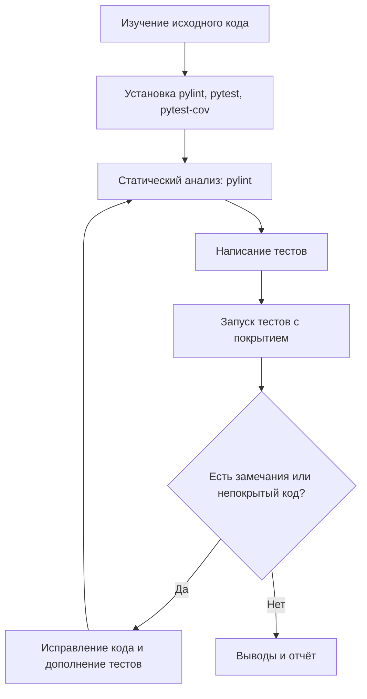

# Отчёт: анализ качества кода с использованием статического анализа и покрытия тестами

**Студент:** Стрельников Михаил Иванович  
**Группа:** 3422А

## Цель

Познакомиться с инструментами статического анализа кода и покрытия тестами на примере Python, применить их на практике к программному модулю и на основе результатов улучшить качество кода.

## Инструменты и окружение

| Инструмент | Версия | Назначение |
|---|---|---|
| Python | 3.13.9 | Язык программирования |
| pylint | 4.1.3 | Статический анализ кода |
| pytest | 9.1.1 | Запуск модульных тестов |
| pytest-cov | 7.1.0 | Измерение покрытия кода тестами |

Установка инструментов:

```bash
python3 -m venv venv
source venv/bin/activate
pip install pylint pytest pytest-cov
```

## Процесс анализа



## 1. Исходный код модуля

Модуль `calculator.py` содержит функции для арифметики, вычисления среднего, проверки простого числа, перевода балла в оценку и расчёта скидки.

```python
import math
import os

def add(a, b):
    return a + b

def subtract(a, b):
    return a - b

def multiply(a, b):
    return a * b

def divide(a, b):
    if b == 0:
        return None
    return a / b

def average(numbers):
    total = 0
    for n in numbers:
        total = total + n
    return total / len(numbers)

def is_prime(n):
    if n < 2:
        return False
    for i in range(2, int(math.sqrt(n)) + 1):
        if n % i == 0:
            return False
    return True

def grade(score):
    if score >= 90:
        return "A"
    elif score >= 75:
        return "B"
    elif score >= 60:
        return "C"
    else:
        return "F"

def discount(price, percent, Unused=None):
    if percent < 0 or percent > 100:
        raise ValueError("bad percent")
    result = price - price * percent / 100
    return round(result, 2)
```

## 2. Результаты статического анализа (pylint)

Команда запуска:

```bash
pylint calculator.py
```

Вывод pylint:

```python
************* Module calculator
calculator.py:1:0: C0114: Missing module docstring (missing-module-docstring)
calculator.py:4:0: C0116: Missing function or method docstring (missing-function-docstring)
calculator.py:7:0: C0116: Missing function or method docstring (missing-function-docstring)
calculator.py:10:0: C0116: Missing function or method docstring (missing-function-docstring)
calculator.py:13:0: C0116: Missing function or method docstring (missing-function-docstring)
calculator.py:18:0: C0116: Missing function or method docstring (missing-function-docstring)
calculator.py:24:0: C0116: Missing function or method docstring (missing-function-docstring)
calculator.py:32:0: C0116: Missing function or method docstring (missing-function-docstring)
calculator.py:33:4: R1705: Unnecessary "elif" after "return", replace only that "elif" with "if" (no-else-return)
calculator.py:42:0: C0116: Missing function or method docstring (missing-function-docstring)
calculator.py:42:29: C0103: Argument name "Unused" doesn't conform to snake_case naming style (invalid-name)
calculator.py:42:29: W0613: Unused argument 'Unused' (unused-argument)
calculator.py:2:0: W0611: Unused import os (unused-import)

-----------------------------------
Your code has been rated at 6.49/10
```

### Сводка замечаний

| Код | Тип | Количество | Описание | Где |
|---|---|---|---|---|
| C0114 | Convention | 1 | Нет docstring у модуля | строка 1 |
| C0116 | Convention | 8 | Нет docstring у функций | все функции |
| C0103 | Convention | 1 | Имя аргумента `Unused` не в стиле snake_case | `discount`, строка 42 |
| R1705 | Refactor | 1 | Лишние `elif`/`else` после `return` | `grade`, строка 33 |
| W0611 | Warning | 1 | Импорт `os` не используется | строка 2 |
| W0613 | Warning | 1 | Аргумент `Unused` не используется | `discount`, строка 42 |
| **Итого** | | **13** | **Оценка: 6.49 / 10** | |

### Ошибка, которую pylint не нашёл

При ручном изучении кода найдена логическая ошибка: функция `average([])` с пустым списком падает с исключением.

```python
>>> average([])
ZeroDivisionError: division by zero
```

Статический анализ проверяет стиль и очевидные ошибки, но не проверяет логику работы, поэтому ему нужны тесты.

## 3. Результаты покрытия тестами (pytest + pytest-cov)

### Набор тестов

```python
import pytest
from calculator import add, subtract, multiply, divide, average, is_prime, grade, discount


def test_add():
    assert add(2, 3) == 5


def test_subtract():
    assert subtract(10, 4) == 6


def test_multiply():
    assert multiply(3, 4) == 12


def test_divide():
    assert divide(10, 2) == 5


def test_average():
    assert average([1, 2, 3, 4]) == 2.5


def test_is_prime():
    assert is_prime(7) is True
    assert is_prime(9) is False


def test_grade():
    assert grade(95) == "A"
    assert grade(50) == "F"


def test_discount():
    assert discount(200, 10) == 180
    with pytest.raises(ValueError):
        discount(100, 150)
```

Команда запуска:

```bash
pytest -v --cov=calculator --cov-report=term-missing test_calculator.py
```

Результат:

```python
test_calculator.py::test_add PASSED                                      [ 12%]
test_calculator.py::test_subtract PASSED                                 [ 25%]
test_calculator.py::test_multiply PASSED                                 [ 37%]
test_calculator.py::test_divide PASSED                                   [ 50%]
test_calculator.py::test_average PASSED                                  [ 62%]
test_calculator.py::test_is_prime PASSED                                 [ 75%]
test_calculator.py::test_grade PASSED                                    [ 87%]
test_calculator.py::test_discount PASSED                                 [100%]

Name            Stmts   Miss  Cover   Missing
---------------------------------------------
calculator.py      37      4    89%   15, 26, 36, 38
---------------------------------------------
TOTAL              37      4    89%
============================== 8 passed in 0.03s ===============================
```

### Непокрытые участки кода

| Строка | Функция | Код | Почему не покрыто | Что проверить |
|---|---|---|---|---|
| 15 | `divide` | `return None` | Нет теста деления на ноль | `divide(1, 0)` |
| 26 | `is_prime` | `return False` | Нет теста для чисел меньше 2 | `is_prime(0)`, `is_prime(1)` |
| 36 | `grade` | `return "B"` | Не проверена оценка B | `grade(80)` |
| 38 | `grade` | `return "C"` | Не проверена оценка C | `grade(60)` |

Все 8 тестов прошли, но покрытие 89%: четыре ветки кода ни разу не выполнялись. Кроме того, ни один тест не проверяет пустой список в `average`, поэтому ошибка `ZeroDivisionError` остаётся незамеченной даже при «зелёных» тестах.

## 4. Рекомендации по улучшению кода

| № | Проблема | Рекомендация | Обоснование |
|---|---|---|---|
| 1 | Неиспользуемый `import os` | Удалить импорт | Лишний код засоряет модуль и замедляет загрузку |
| 2 | Нет docstring у модуля и функций | Добавить описание к модулю и каждой функции | Код понятнее, работает `help()`, легче сопровождать |
| 3 | Лишний аргумент `Unused` | Удалить его из `discount` | Вводит в заблуждение и нарушает стиль именования PEP 8 |
| 4 | `elif`/`else` после `return` в `grade` | Заменить на отдельные `if` | Меньше вложенности, код читается проще |
| 5 | `average([])` → `ZeroDivisionError` | Проверять пустой список и выбрасывать `ValueError` с понятным текстом | Ошибка становится явной и понятной вызывающему коду |
| 6 | Ручной цикл суммирования в `average` | Использовать встроенную `sum()` | Короче и быстрее |
| 7 | `int(math.sqrt(n))` в `is_prime` | Использовать `math.isqrt(n)` | Точное целочисленное значение без ошибок округления на больших числах |
| 8 | Сообщение `"bad percent"` | Писать понятное сообщение об ошибке | Пользователю ясно, какое значение допустимо |
| 9 | Непокрытые ветки (строки 15, 26, 36, 38) | Добавить тесты на граничные значения и все ветки, использовать `@pytest.mark.parametrize` | Каждая ветка кода должна выполняться хотя бы в одном тесте |

### Исправленный модуль

```python
"""Модуль простых математических операций."""
import math


def add(a, b):
    """Возвращает сумму двух чисел."""
    return a + b


def subtract(a, b):
    """Возвращает разность двух чисел."""
    return a - b


def multiply(a, b):
    """Возвращает произведение двух чисел."""
    return a * b


def divide(a, b):
    """Делит a на b. Возвращает None при делении на ноль."""
    if b == 0:
        return None
    return a / b


def average(numbers):
    """Возвращает среднее арифметическое списка чисел."""
    if not numbers:
        raise ValueError("Список чисел пуст")
    return sum(numbers) / len(numbers)


def is_prime(n):
    """Проверяет, является ли число простым."""
    if n < 2:
        return False
    for i in range(2, math.isqrt(n) + 1):
        if n % i == 0:
            return False
    return True


def grade(score):
    """Переводит балл в буквенную оценку."""
    if score >= 90:
        return "A"
    if score >= 75:
        return "B"
    if score >= 60:
        return "C"
    return "F"


def discount(price, percent):
    """Возвращает цену со скидкой percent процентов."""
    if percent < 0 or percent > 100:
        raise ValueError("Процент скидки должен быть от 0 до 100")
    result = price - price * percent / 100
    return round(result, 2)
```

### Дополненные тесты

```python
"""Тесты для модуля calculator."""
import pytest
from calculator import add, subtract, multiply, divide, average, is_prime, grade, discount


def test_add():
    """Сложение."""
    assert add(2, 3) == 5
    assert add(-1, 1) == 0


def test_subtract():
    """Вычитание."""
    assert subtract(10, 4) == 6


def test_multiply():
    """Умножение."""
    assert multiply(3, 4) == 12
    assert multiply(5, 0) == 0


def test_divide():
    """Деление, в том числе на ноль."""
    assert divide(10, 2) == 5
    assert divide(1, 0) is None


def test_average():
    """Среднее и пустой список."""
    assert average([1, 2, 3, 4]) == 2.5
    with pytest.raises(ValueError):
        average([])


@pytest.mark.parametrize("n, expected", [(0, False), (1, False), (2, True), (7, True), (9, False)])
def test_is_prime(n, expected):
    """Простые и составные числа, граничные значения."""
    assert is_prime(n) is expected


@pytest.mark.parametrize("score, expected", [(95, "A"), (90, "A"), (80, "B"), (60, "C"), (59, "F")])
def test_grade(score, expected):
    """Все ветки оценок и границы."""
    assert grade(score) == expected


def test_discount():
    """Скидка и неверный процент."""
    assert discount(200, 10) == 180
    assert discount(99.99, 0) == 99.99
    with pytest.raises(ValueError):
        discount(100, 150)
    with pytest.raises(ValueError):
        discount(100, -5)
```

### Повторный анализ после исправлений

```python
$ pylint calculator.py
-------------------------------------------------------------------
Your code has been rated at 10.00/10 (previous run: 6.49/10, +3.51)

$ pytest --cov=calculator --cov-report=term-missing test_calculator.py
Name            Stmts   Miss  Cover   Missing
---------------------------------------------
calculator.py      35      0   100%
---------------------------------------------
TOTAL              35      0   100%
============================== 16 passed in 0.03s ==============================
```

### Сравнение «до» и «после»

| Показатель | До | После |
|---|---|---|
| Оценка pylint | 6.49 / 10 | **10.00 / 10** |
| Замечаний pylint | 13 | **0** |
| Количество тестов | 8 | **16** |
| Покрытие кода | 89% | **100%** |
| Непокрытых строк | 4 | **0** |
| Логических ошибок | 1 (`average([])`) | **0** |

## 5. Выводы о качестве кода

1. **Исходный модуль работал на обычных данных, но был низкого качества:** pylint оценил его на 6.49 из 10. Основные проблемы — отсутствие документации, неиспользуемый импорт и аргумент, лишние ветки `else`.
2. **Статический анализ находит проблемы стиля и «мёртвый» код** без запуска программы, но не видит логических ошибок. Ошибку деления на ноль в `average` он пропустил.
3. **Покрытие тестами показывает, какой код ни разу не выполнялся.** При 8 успешных тестах покрытие было 89%: не проверялись деление на ноль, числа меньше 2 и оценки B и C. Поэтому «все тесты прошли» ещё не значит, что код проверен.
4. **100% покрытия не гарантирует отсутствие ошибок.** Ошибку в `average` нашёл только тест на граничный случай — пустой список. Поэтому кроме покрытия важно проверять граничные и некорректные входные данные.
5. **После исправлений** модуль получил 10/10 в pylint и 100% покрытия при 16 тестах. Найденная ошибка исправлена, код стал понятнее и проще в сопровождении.
6. **Эти инструменты стоит использовать вместе и регулярно**, например запускать pylint и pytest-cov автоматически перед каждым коммитом или в CI. Тогда качество кода не будет ухудшаться со временем.
