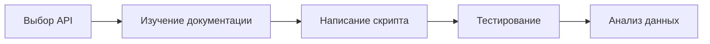
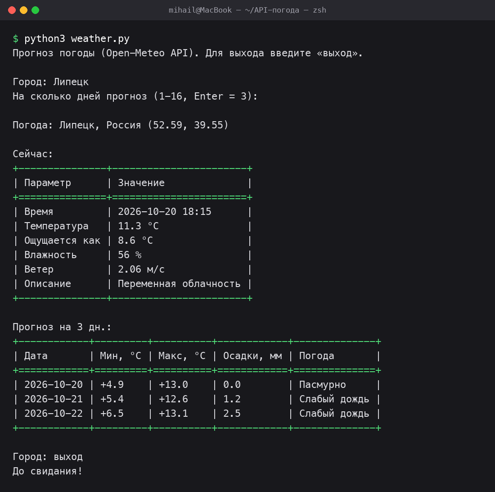
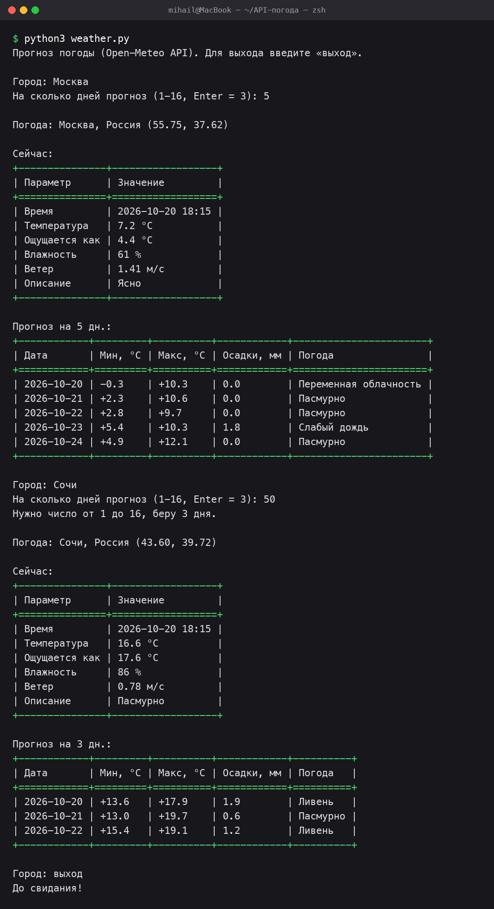
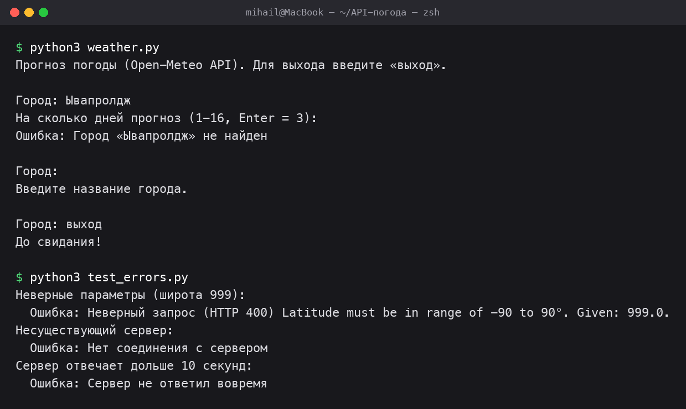

# Отчёт: анализ и использование инструментов для работы с API

**Студент:** Стрельников Михаил Иванович
**Группа:** 3422А

## Цель

Изучить и применить инструменты для работы с API и обмена данными между модулями в Python: отправить HTTP-запрос к открытому API, получить ответ в формате JSON, обработать его и вывести в виде таблицы.

## Используемые инструменты

| Инструмент | Назначение |
|---|---|
| Python 3.13 | Язык программирования |
| `requests` | Библиотека для отправки HTTP-запросов |
| Open-Meteo Geocoding API | Поиск координат города по названию |
| Open-Meteo Forecast API | Текущая погода и прогноз по координатам |
| JSON | Формат обмена данными между API и скриптом |

## Схема выполнения работы



## Шаг 1. Выбор API

Выбран **Open-Meteo** (open-meteo.com) — бесплатный открытый API погоды.

Почему именно он:
- не нужна регистрация и API-ключ;
- отвечает в формате JSON;
- поддерживает русский язык в названиях городов;
- даёт и текущую погоду, и прогноз до 16 дней.

## Шаг 2. Изучение документации

Для задачи нужны два метода API.

### Поиск города — Geocoding API

`GET https://geocoding-api.open-meteo.com/v1/search`

| Параметр | Пример | Описание |
|---|---|---|
| `name` | `Липецк` | Название города |
| `count` | `1` | Сколько результатов вернуть |
| `language` | `ru` | Язык названий в ответе |

Фрагмент ответа (JSON):

```json
{
  "results": [
    {
      "name": "Липецк",
      "latitude": 52.5876,
      "longitude": 39.55151,
      "country": "Россия",
      "timezone": "Europe/Moscow"
    }
  ]
}
```

Если город не найден, в ответе нет ключа `results`.

### Прогноз погоды — Forecast API

`GET https://api.open-meteo.com/v1/forecast`

| Параметр | Пример | Описание |
|---|---|---|
| `latitude`, `longitude` | `52.59`, `39.55` | Координаты места |
| `current` | `temperature_2m,relative_humidity_2m,...` | Какие показатели нужны на текущий момент |
| `daily` | `temperature_2m_min,temperature_2m_max,...` | Какие показатели нужны по дням |
| `forecast_days` | `3` | На сколько дней прогноз (1–16) |
| `wind_speed_unit` | `ms` | Скорость ветра в м/с |
| `timezone` | `auto` | Время по часовому поясу места |

Используемые показатели:

| Показатель | Что означает |
|---|---|
| `temperature_2m` | Температура воздуха, °C |
| `apparent_temperature` | Ощущаемая температура, °C |
| `relative_humidity_2m` | Влажность, % |
| `wind_speed_10m` | Скорость ветра, м/с |
| `weather_code` | Код погоды по стандарту WMO (0 — ясно, 61 — дождь, 95 — гроза и т. д.) |
| `precipitation_sum` | Сумма осадков за день, мм |

При неверных параметрах API возвращает код **400** и причину в поле `reason`.

## Шаг 3. Написание скрипта

Скрипт разбит на функции, каждая делает одну задачу:

| Функция | Что делает |
|---|---|
| `get_data(api_url, params)` | Отправляет GET-запрос, проверяет код ответа, возвращает JSON. Перехватывает ошибки и превращает их в понятное `ApiError` |
| `find_city(name)` | Находит координаты города через Geocoding API |
| `get_weather(lat, lon, days)` | Получает текущую погоду и прогноз через Forecast API |
| `print_table(headers, rows)` | Печатает таблицу с заголовками; ширина столбцов подбирается автоматически |
| `show_weather(city, weather)` | Выводит две таблицы: «Сейчас» и «Прогноз по дням» |
| `ask_days()` | Спрашивает число дней прогноза и проверяет ввод |
| `main()` | Цикл `while True`: можно запрашивать погоду для разных городов, пока не введено «выход» |

### Обработка ошибок

| Ситуация | Как обрабатывается | Что видит пользователь |
|---|---|---|
| Сервер не отвечает дольше 10 с | `requests.exceptions.Timeout` | «Сервер не ответил вовремя» |
| Нет интернета / неверный адрес | `requests.exceptions.ConnectionError` | «Нет соединения с сервером» |
| Неверный запрос (код 4xx/5xx) | `raise_for_status()` → `HTTPError` | «Неверный запрос (HTTP 400)» + причина от API |
| Ответ не в формате JSON | `ValueError` | «Сервер вернул ответ не в формате JSON» |
| Город не найден | Проверка `results` в ответе | «Город «…» не найден» |
| Пустой ввод города | Проверка в цикле | «Введите название города.» |
| Неверное число дней | Проверка `ask_days()` | «Нужно число от 1 до 16, беру 3 дня.» |

Во всех случаях скрипт не падает, а выводит сообщение и продолжает работу.

### Код скрипта `weather.py`

```python
"""
Скрипт получения прогноза погоды через открытый API Open-Meteo.

Пользователь вводит название города, скрипт:
1) находит координаты города (Geocoding API),
2) получает текущую погоду и прогноз на несколько дней (Forecast API),
3) выводит результат в виде таблиц.
Запросы можно повторять в цикле, пока пользователь не введёт «выход».
"""

import requests

GEOCODING_URL = "https://geocoding-api.open-meteo.com/v1/search"
FORECAST_URL = "https://api.open-meteo.com/v1/forecast"
REQUEST_TIMEOUT = 10  # секунд ожидания ответа от сервера

# Коды погоды WMO -> понятное описание
WEATHER_CODES = {
    0: "Ясно", 1: "Преимущественно ясно", 2: "Переменная облачность", 3: "Пасмурно",
    45: "Туман", 48: "Изморозь",
    51: "Слабая морось", 53: "Морось", 55: "Сильная морось",
    61: "Слабый дождь", 63: "Дождь", 65: "Сильный дождь",
    71: "Слабый снег", 73: "Снег", 75: "Сильный снег",
    80: "Ливень", 81: "Ливень", 82: "Сильный ливень",
    95: "Гроза", 96: "Гроза с градом", 99: "Гроза с градом",
}


class ApiError(Exception):
    """Ошибка при обращении к API."""


def get_data(api_url, params=None):
    """Отправляет GET-запрос к API и возвращает ответ в виде словаря (JSON)."""
    try:
        response = requests.get(api_url, params=params or {}, timeout=REQUEST_TIMEOUT)
        response.raise_for_status()  # ошибка, если код ответа 4xx или 5xx
        return response.json()
    except requests.exceptions.Timeout as error:
        raise ApiError("Сервер не ответил вовремя") from error
    except requests.exceptions.ConnectionError as error:
        raise ApiError("Нет соединения с сервером") from error
    except requests.exceptions.HTTPError as error:
        # Open-Meteo в теле ответа объясняет, что не так с запросом
        try:
            reason = response.json().get("reason", "")
        except ValueError:
            reason = ""
        raise ApiError(f"Неверный запрос (HTTP {response.status_code}) {reason}".strip()) from error
    except ValueError as error:
        raise ApiError("Сервер вернул ответ не в формате JSON") from error


def find_city(name):
    """Ищет город по названию и возвращает его данные (координаты, страна)."""
    data = get_data(GEOCODING_URL, {"name": name, "count": 1, "language": "ru"})
    results = data.get("results")
    if not results:
        raise ApiError(f"Город «{name}» не найден")
    return results[0]


def get_weather(latitude, longitude, days):
    """Получает текущую погоду и прогноз на указанное число дней."""
    params = {
        "latitude": latitude,
        "longitude": longitude,
        "current": "temperature_2m,apparent_temperature,relative_humidity_2m,"
                   "wind_speed_10m,weather_code",
        "daily": "temperature_2m_min,temperature_2m_max,precipitation_sum,weather_code",
        "wind_speed_unit": "ms",
        "timezone": "auto",
        "forecast_days": days,
    }
    return get_data(FORECAST_URL, params)


def print_table(headers, rows):
    """Печатает таблицу: ширина каждого столбца подбирается по самому длинному значению."""
    widths = [max(len(str(item)) for item in column) for column in zip(headers, *rows)]
    line = "+" + "+".join("-" * (width + 2) for width in widths) + "+"

    def format_row(row):
        return "| " + " | ".join(str(item).ljust(width) for item, width in zip(row, widths)) + " |"

    print(line)
    print(format_row(headers))
    print(line.replace("-", "="))
    for row in rows:
        print(format_row(row))
    print(line)


def show_weather(city, weather):
    """Выводит текущую погоду и прогноз по дням в виде таблиц."""
    current = weather["current"]
    units = weather["current_units"]

    print(f"\nПогода: {city['name']}, {city.get('country', '')} "
          f"({city['latitude']:.2f}, {city['longitude']:.2f})")
    print("\nСейчас:")
    print_table(
        ["Параметр", "Значение"],
        [
            ["Время", current["time"].replace("T", " ")],
            ["Температура", f"{current['temperature_2m']} {units['temperature_2m']}"],
            ["Ощущается как", f"{current['apparent_temperature']} {units['apparent_temperature']}"],
            ["Влажность", f"{current['relative_humidity_2m']} {units['relative_humidity_2m']}"],
            ["Ветер", f"{current['wind_speed_10m']} м/с"],
            ["Описание", WEATHER_CODES.get(current["weather_code"], "Неизвестно")],
        ],
    )

    daily = weather["daily"]
    rows = []
    for i, date in enumerate(daily["time"]):
        rows.append([
            date,
            f"{daily['temperature_2m_min'][i]:+.1f}",
            f"{daily['temperature_2m_max'][i]:+.1f}",
            f"{daily['precipitation_sum'][i]:.1f}",
            WEATHER_CODES.get(daily["weather_code"][i], "Неизвестно"),
        ])
    print(f"\nПрогноз на {len(rows)} дн.:")
    print_table(["Дата", "Мин, °C", "Макс, °C", "Осадки, мм", "Погода"], rows)


def ask_days():
    """Спрашивает число дней прогноза (1–16). По умолчанию — 3."""
    answer = input("На сколько дней прогноз (1-16, Enter = 3): ").strip()
    if not answer:
        return 3
    if not answer.isdigit() or not 1 <= int(answer) <= 16:
        print("Нужно число от 1 до 16, беру 3 дня.")
        return 3
    return int(answer)


def main():
    """Основной цикл: запрашиваем город, пока пользователь не введёт «выход»."""
    print("Прогноз погоды (Open-Meteo API). Для выхода введите «выход».")
    while True:
        name = input("\nГород: ").strip()
        if name.lower() in ("выход", "exit", "q"):
            print("До свидания!")
            break
        if not name:
            print("Введите название города.")
            continue

        days = ask_days()
        try:
            city = find_city(name)
            weather = get_weather(city["latitude"], city["longitude"], days)
            show_weather(city, weather)
        except ApiError as error:
            print(f"Ошибка: {error}")


if __name__ == "__main__":
    main()
```

## Шаг 4. Тестирование

Скрипт запускался командой `python3 weather.py`. Параметры запроса менялись: разные города, разное число дней прогноза, некорректные данные.

### Тест 1. Липецк, прогноз по умолчанию (3 дня)

Число дней не введено (нажат Enter), поэтому скрипт взял значение по умолчанию — 3 дня.



### Тест 2. Несколько запросов подряд: Москва (5 дней) и Сочи (неверное число дней)

В одном запуске подряд сделаны два запроса — так проверена работа цикла. Для Сочи введено число 50, скрипт сообщил об ошибке и взял 3 дня.



### Тест 3. Обработка ошибок

- несуществующий город «Ывапролдж»;
- пустой ввод города;
- отдельный скрипт `test_errors.py` проверяет функцию `get_data` на неверных параметрах, недоступном сервере и долгом ответе.

```python
"""Проверка обработки ошибок в функции get_data."""
from weather import get_data, ApiError, FORECAST_URL

CASES = [
    ("Неверные параметры (широта 999)", FORECAST_URL, {"latitude": 999, "longitude": 0, "current": "temperature_2m"}),
    ("Несуществующий сервер", "https://api.open-meteo.invalid/v1/forecast", None),
    ("Сервер отвечает дольше 10 секунд", "https://httpbin.org/delay/15", None),
]

for title, url, params in CASES:
    try:
        get_data(url, params)
        print(f"{title}: ошибки нет")
    except ApiError as error:
        print(f"{title}:\n  Ошибка: {error}")
```



### Итоги тестирования

| № | Входные данные | Ожидаемый результат | Фактический результат | Статус |
|---|---|---|---|---|
| 1 | Липецк, Enter | Погода + прогноз на 3 дня | Таблицы выведены, 3 дня | ✅ |
| 2 | Москва, 5 | Прогноз на 5 дней | 5 строк в прогнозе | ✅ |
| 3 | Сочи, 50 | Сообщение об ошибке, 3 дня | «Нужно число от 1 до 16, беру 3 дня» | ✅ |
| 4 | Ывапролдж | Город не найден | «Город «Ывапролдж» не найден» | ✅ |
| 5 | Пустой ввод | Просьба ввести город | «Введите название города.» | ✅ |
| 6 | Широта 999 | Ошибка 400 с причиной | «Неверный запрос (HTTP 400) Latitude must be in range of -90 to 90°» | ✅ |
| 7 | Несуществующий сервер | Ошибка соединения | «Нет соединения с сервером» | ✅ |
| 8 | Ответ дольше 10 с | Ошибка таймаута | «Сервер не ответил вовремя» | ✅ |
| 9 | «выход» | Завершение цикла | «До свидания!» | ✅ |

## Шаг 5. Анализ полученных данных

Данные получены 20.10.2026 около 18:15 по местному времени.

### Текущая погода

| Город | Координаты | Температура | Ощущается как | Влажность | Ветер | Погода |
|---|---|---|---|---|---|---|
| Липецк | 52.59, 39.55 | 11.3 °C | 8.6 °C | 56 % | 2.06 м/с | Переменная облачность |
| Москва | 55.75, 37.62 | 7.2 °C | 4.4 °C | 61 % | 1.41 м/с | Ясно |
| Сочи | 43.60, 39.72 | 16.6 °C | 17.6 °C | 86 % | 0.78 м/с | Пасмурно |

### Прогноз по дням

| Город | Дата | Мин, °C | Макс, °C | Осадки, мм | Погода |
|---|---|---|---|---|---|
| Липецк | 20.10 | +4.9 | +13.0 | 0.0 | Пасмурно |
| Липецк | 21.10 | +5.4 | +12.6 | 1.2 | Слабый дождь |
| Липецк | 22.10 | +6.5 | +13.1 | 2.5 | Слабый дождь |
| Москва | 20.10 | −0.3 | +10.3 | 0.0 | Переменная облачность |
| Москва | 21.10 | +2.3 | +10.6 | 0.0 | Пасмурно |
| Москва | 22.10 | +2.8 | +9.7 | 0.0 | Пасмурно |
| Москва | 23.10 | +5.4 | +10.3 | 1.8 | Слабый дождь |
| Москва | 24.10 | +4.9 | +12.1 | 0.0 | Пасмурно |
| Сочи | 20.10 | +13.6 | +17.9 | 1.9 | Ливень |
| Сочи | 21.10 | +13.0 | +19.7 | 0.6 | Пасмурно |
| Сочи | 22.10 | +15.4 | +19.1 | 1.2 | Ливень |

Что видно из данных:
- Самый тёплый город — Сочи (южнее остальных): днём до +19.7 °C, ночью не ниже +13 °C. Но там же самая высокая влажность (86 %) и ливни.
- Самый холодный — Москва: ночью 20.10 до −0.3 °C, при ясном небе ощущается всего на 4.4 °C.
- В Липецке в ближайшие дни ожидается слабый дождь, суммарно 3.7 мм за 2 дня.
- Ощущаемая температура в Липецке и Москве ниже реальной на 2–3 °C из-за ветра, а в Сочи — выше из-за высокой влажности.

## Выводы

1. Изучен открытый API Open-Meteo: определены нужные методы (поиск города и прогноз) и их параметры. Данные между API и скриптом передаются в формате JSON, который в Python превращается в обычный словарь методом `response.json()`.
2. Написан скрипт на Python с библиотекой `requests`. Он отправляет HTTP-запросы, обрабатывает ответ и выводит данные в виде таблиц с заголовками.
3. Работа с API вынесена в отдельную функцию `get_data`. Остальные функции не знают, как устроен HTTP, а только получают готовые данные, поэтому код легко расширять: можно подключить другой API, не меняя вывод.
4. Цикл `while` позволяет делать сколько угодно запросов за один запуск.
5. Обработаны все основные ошибки: неверный запрос, отсутствие соединения, таймаут, неверный формат ответа, ненайденный город и неверный ввод пользователя. Скрипт при ошибке не падает, а сообщает, что пошло не так.
6. Все 9 тестов пройдены. Скрипт корректно работает с разными городами и параметрами.
